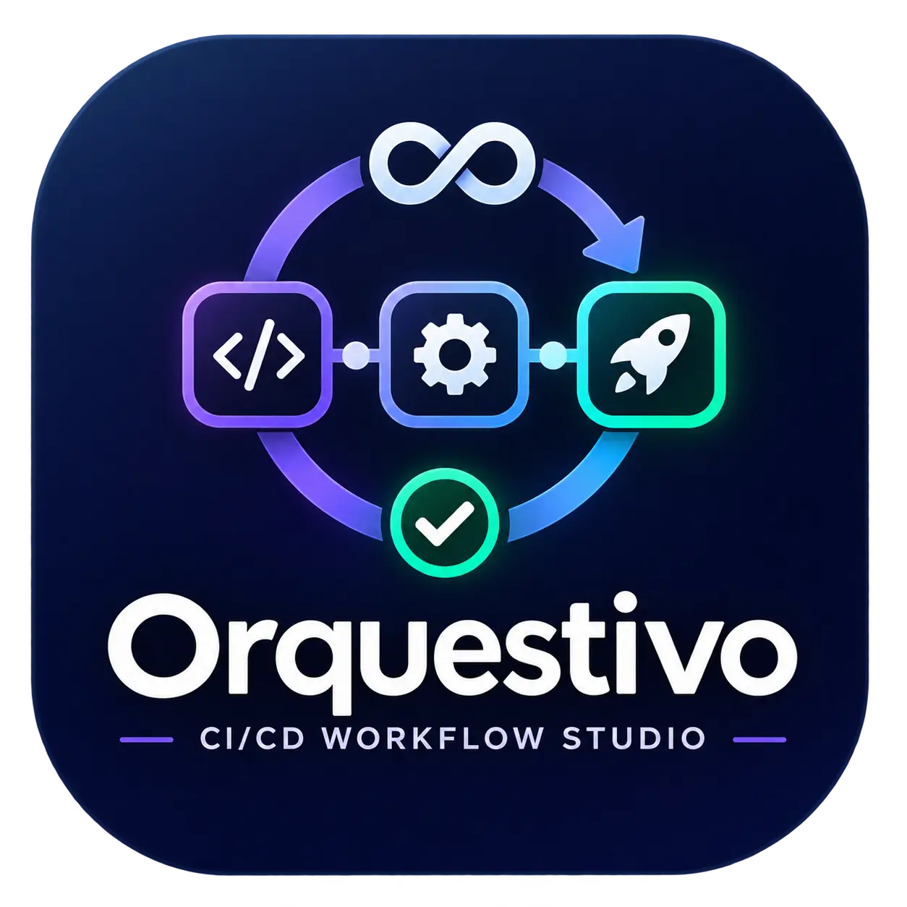
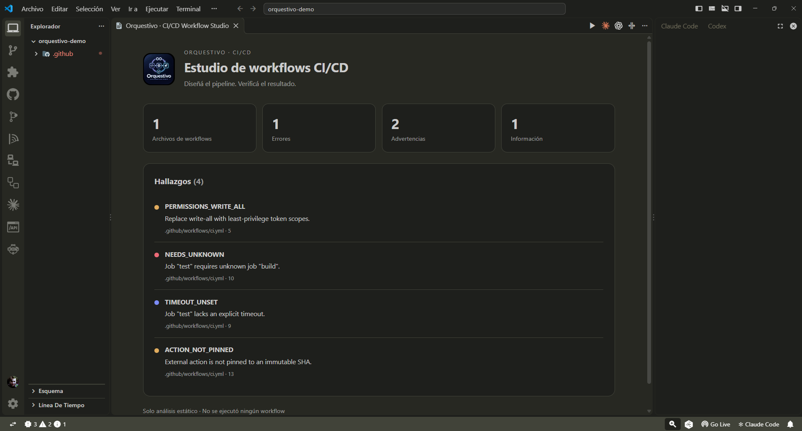
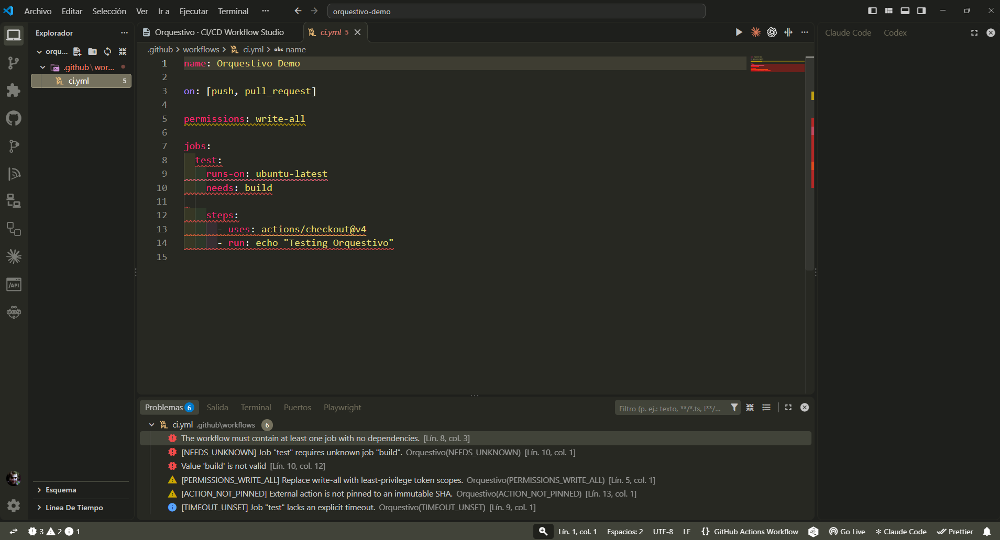
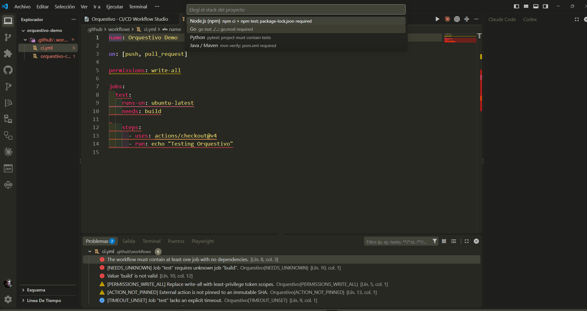

<p align="center">
  
</p>

<p align="center">
  <strong>Design the pipeline. Verify the outcome.</strong><br />
  GitHub Actions workflow analysis and safe CI scaffolding inside Visual Studio Code.
</p>

<p align="center">
  
  
  
  
</p>

<p align="center">
  <a href="#quick-start">Quick start</a> ·
  <a href="#what-it-does-today">Features</a> ·
  <a href="#screenshots">Screenshots</a> ·
  <a href="#limitations-and-trust-model">Limitations</a> ·
  <a href="#development-and-verification">Development</a> ·
  <a href="#contributing">Contributing</a>
</p>

---

## Why Orquestivo?

A pipeline can be valid YAML and still be **unsafe, fragile or incorrect for its intended purpose**. Orquestivo is an open-source, local-first VS Code extension that helps you inspect GitHub Actions workflows and generate conservative CI starting points.

**Current status: v0.1.0 foundation, not yet published.** Orquestivo currently performs **static checks**, not pipeline execution, deployment verification, or proof that a workflow meets business requirements. The long-term vision is larger; features not implemented are listed explicitly below.

## What it does today

| Area | Current capability |
| --- | --- |
| Discover | Read `.github/workflows/*.yml` and `*.yaml` in a trusted workspace |
| Validate | Parse YAML, report malformed documents and duplicate keys |
| Understand jobs | Detect missing dependencies, self-dependencies and dependency cycles |
| Flag risk | Warn about broad token permissions, mutable action references and privileged PR contexts |
| Improve reliability | Detect selected structural issues and missing job timeouts |
| Work natively | View findings in **Problems**, the **Activity Bar** and the **Control Center** |
| Generate starters | Review CI templates for **Node.js/npm, Go, Python/pytest and Java/Maven** before creating files |
| Localize | English and Spanish UI shell; full rule-message localization is still in progress |

Diagnostics identify supported static patterns. A clean scan **does not mean** a workflow has run, is secure in every context or will deploy successfully.

## Screenshots

A look at the current Orquestivo 0.1.0 preview inside Visual Studio Code. Click any image to open it at full resolution.

### 1. Control Center — scan overview

The Control Center summarizes analyzed workflow files, errors, warnings and informational findings. It also lists rule identifiers and source locations for investigation.

<p align="center">
  <a href="media/01.png">
    
  </a>
</p>
<p align="center"><sub>Control Center · Resumen de análisis y hallazgos</sub></p>

### 2. Workflow diagnostics — review findings in context

Open the workflow YAML and inspect issues alongside the native **Problems** panel. Orquestivo findings can coexist with diagnostics from other installed GitHub Actions or YAML extensions.

<p align="center">
  <a href="media/02.png">
    
  </a>
</p>
<p align="center"><sub>Diagnostics · Errores y advertencias contextualizados en el editor</sub></p>

### 3. CI generator — choose your project stack

Use **Orquestivo: Generate safe CI workflow** to select a Node.js/npm, Go, Python/pytest or Java/Maven starter. Orquestivo previews the YAML and asks for confirmation before creating the workflow.

<p align="center">
  <a href="media/03.png">
    
  </a>
</p>
<p align="center"><sub>CI generator · Selección del stack del proyecto</sub></p>

> These images document the **static-analysis and starter-generation preview**. They do not demonstrate execution, deployment or verification of a pipeline's intended outcome.


## Quick start

### Try the development preview

The extension is **not yet published** to the Visual Studio Marketplace or Open VSX. Build the VSIX locally, or use the preview VSIX artifact from a successful CI run on [PR #1](https://github.com/Drako01/orquestivo/pull/1).

Prerequisites: **VS Code 1.99+**, **Node.js 22+** and npm. For analysis, open a **trusted** repository containing GitHub Actions workflow YAML files.

```bash
git clone https://github.com/Drako01/orquestivo.git
cd orquestivo
git switch feat/mvp-foundation
npm ci
npm run package
```

In VS Code, select **Extensions → ··· → Install from VSIX…** and choose `orquestivo.vsix`. Open a trusted project and use the Command Palette:

1. **Orquestivo: Analyze GitHub Actions workflows** — scans supported workflow files and opens diagnostics.
2. **Orquestivo: Generate safe CI workflow** — creates a reviewed starter template only after confirmation.
3. Click the **Orquestivo** Activity Bar icon to open the **Control Center** immediately. The sidebar retains the workflow diagnostics tree so you can navigate individual findings.

If you install a preview artifact from CI, verify its build and source commit. Avoid treating preview packages as production-certified releases.

## How to interpret findings

Findings belong to the **static-analysis** category. They may point to YAML structure, job dependencies, action pinning, permissions, or selected injection-prone expressions. Review the referenced source location and validate the proposed change in your own CI environment.

Orquestivo intentionally distinguishes:

| Evidence | What it establishes |
| --- | --- |
| YAML parsed | Syntax was understood by the parser |
| Static analysis completed | Supported rules were evaluated |
| Actual CI run | Only a real runner can establish execution status |
| Intended outcome verified | Requires explicit acceptance criteria and separate evidence |

The final two levels are **not implemented in v0.1.0**.

## Limitations and trust model

- **GitHub Actions only.** No GitLab CI, Azure Pipelines or Jenkins support yet.
- **Partial semantic coverage.** Expressions, event filters, matrices, conditions, artifacts and GitHub Actions schema are not exhaustively validated.
- **No autonomous execution.** The analyzer does not invoke workflow commands or run deployment jobs.
- **No GitHub sign-in or cloud service required.** The current extension reads local workflow files and keeps diagnostics in memory.
- **No AI, runtime verification or guaranteed fixes.** These are roadmap items, not present-day capabilities.
- **Workspace Trust matters.** Scans in the current MVP require a trusted workspace and bounded file reads.

See [Security](SECURITY.md), [Privacy](PRIVACY.md), [Architecture](ARCHITECTURE.md), and the [Roadmap](ROADMAP.md).

## Development and verification

```bash
npm ci
npm run typecheck
npm run lint
npm run rulesets:check
npm test
npm run test:coverage
npm run verify
npm run test:integration
npm run package
npm audit --omit=dev --audit-level=high
```

`npm run verify` repeats typecheck, lint, ruleset validation, unit tests and production build. The VS Code integration test starts an Extension Host and may download a test copy of VS Code. A passing smoke test does not replace manual UX and accessibility validation.

**Architecture:** `src/core/` contains the analyzer and generator; `src/extension.ts` connects these to VS Code; `test/` contains deterministic tests. Source files use strict TypeScript. See [ARCHITECTURE.md](ARCHITECTURE.md) for boundaries and security assumptions.

## Quality, roadmap and release status

This project targets **Enterprise AAAA engineering practices**, but this is an **objective, not a current certification**. Open release gates include complete behavioral coverage, source-based test coverage, expanded packaged E2E, accessibility, comprehensive EN/ES localization, threat modeling, and publishing verification.

Review the evidence-backed [Release Readiness checklist](RELEASE_READINESS.md), [release process](docs/RELEASE.md), and [GitHub ruleset governance](docs/RULESETS.md). Publication is manual and requires maintainer approval.

## Contributing

**Contributions are welcome — ¡Se aceptan contribuciones!** Developers, DevOps engineers, QA specialists, translators, designers and accessibility reviewers can help improve Orquestivo.

Start with [CONTRIBUTING.md](CONTRIBUTING.md) for environment setup, suitable first contributions, review requirements and PR acceptance criteria. Please also read the [Code of Conduct](CODE_OF_CONDUCT.md).

- [Open an issue](https://github.com/Drako01/orquestivo/issues) for a reproducible bug or a scoped enhancement.
- [Review the roadmap](ROADMAP.md) to find unimplemented capabilities.
- [Open a pull request](https://github.com/Drako01/orquestivo/pulls) against `main` once your branch and tests are ready. Do not commit secrets or private CI logs.

## Support, security and license

For functional issues, use [GitHub Issues](https://github.com/Drako01/orquestivo/issues) or [ArmoTuSitio support](https://armotusitio.com.ar/soporte/). **Report vulnerabilities privately**, following [SECURITY.md](SECURITY.md); do not open public issues containing exploit details, tokens or confidential workflow data.

Distributed under the **MIT License**. See [LICENSE](LICENSE).

---

<p align="center">
  <strong>Designed and developed by Alejandro Daniel Di Stefano</strong><br />
  © 2026 <a href="https://armotusitio.com.ar">ArmoTuSitio</a> · Open source under the MIT License
</p>
