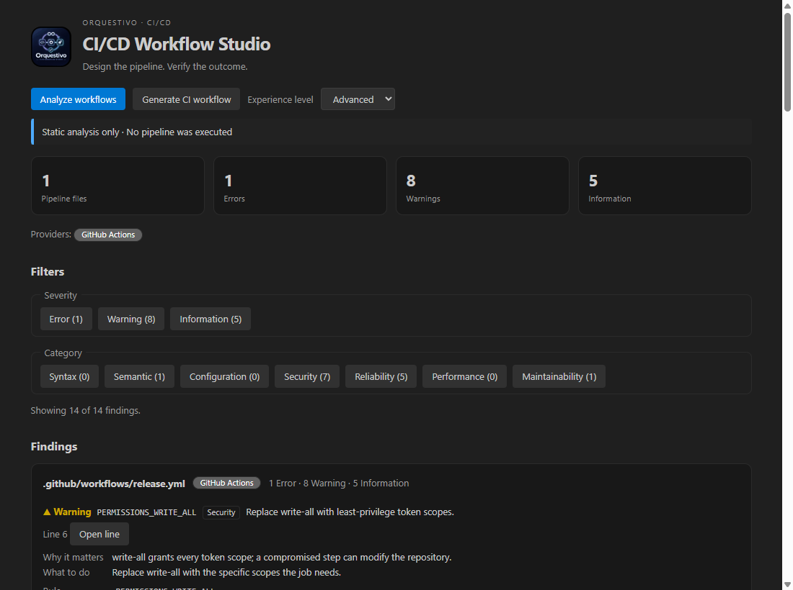
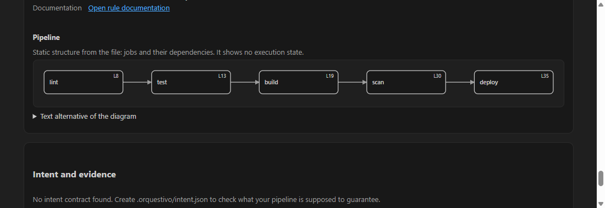
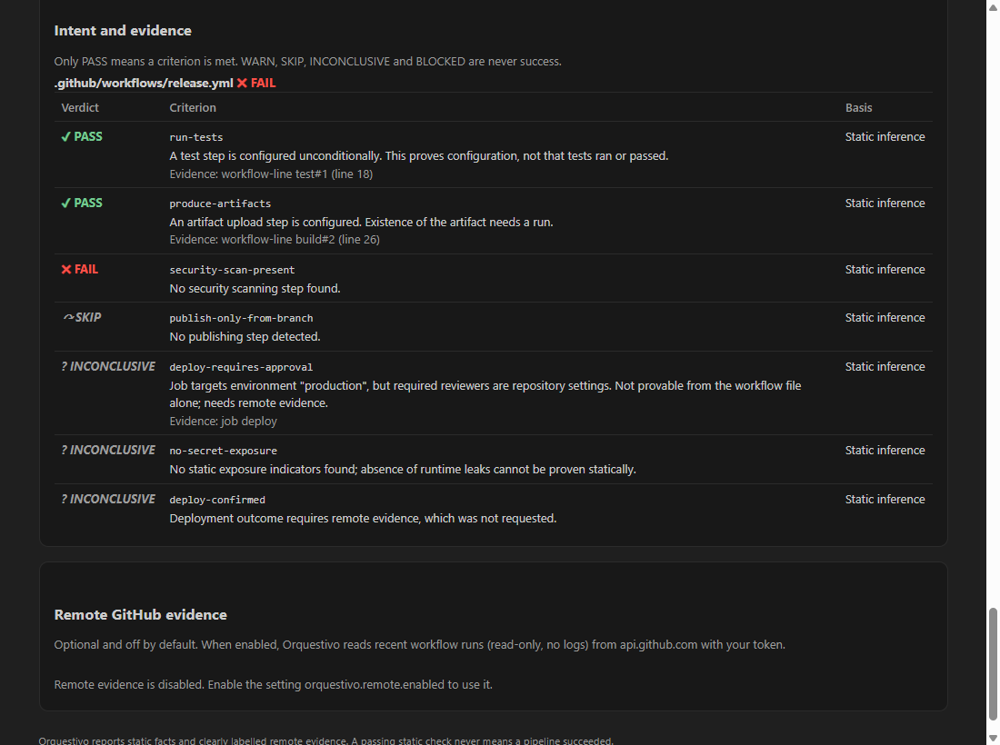

<p align="center">
  
</p>

<p align="center">
  <strong>Design the pipeline. Verify the outcome.</strong><br />
  Multi-provider CI/CD analysis, intent contracts and safe CI scaffolding inside Visual Studio Code.
</p>

<p align="center">
  
  
  
  
</p>

<p align="center">
  <a href="#quick-start">Quick start</a> ·
  <a href="#what-it-does">Features</a> ·
  <a href="#screenshots">Screenshots</a> ·
  <a href="#limitations-and-trust-model">Limitations</a> ·
  <a href="#development-and-verification">Development</a> ·
  <a href="#contributing">Contributing</a>
</p>

---

## Why Orquestivo?

A pipeline can be valid YAML and still be **unsafe, fragile or incorrect for its intended purpose**. Orquestivo is an open-source, local-first VS Code extension that inspects CI/CD pipelines, checks them against what you say they must achieve, and generates conservative CI starting points.

**Current status: public preview (`0.1.1`).** Published to the Visual Studio Marketplace and Open VSX as a preview. See [CHANGELOG.md](CHANGELOG.md) and [ROADMAP.md](ROADMAP.md). Known gaps (real GitHub E2E, WSL/SSH/Dev Containers checks, manual accessibility audit) are tracked honestly in [RELEASE_READINESS.md](RELEASE_READINESS.md).

Orquestivo reports **static inference** by default. It does not run your pipeline. Only opt-in, read-only evidence from real GitHub Actions runs can back a statement about what actually happened, and even then it does not prove business requirements are met.

## What it does

| Area | Capability |
| --- | --- |
| Multi-provider analysis | **GitHub Actions** (68 rule codes), **GitLab CI/CD**, **Azure Pipelines** and **Jenkins** (declarative Jenkinsfile). Rule details: [docs/ANALYSIS.md](docs/ANALYSIS.md), [docs/PROVIDERS.md](docs/PROVIDERS.md) |
| Control Center | Webview with an accessible pipeline diagram (with a textual alternative) and three explanation levels: **beginner**, **advanced**, **expert** |
| Intent contracts | `.orquestivo/intent.json` states what the pipeline must achieve; each criterion yields **PASS / FAIL / WARN / SKIP / INCONCLUSIVE / BLOCKED**. See [docs/EVIDENCE.md](docs/EVIDENCE.md) |
| Run evidence (opt-in) | Read-only GitHub Actions run metadata, with a token kept in VS Code **SecretStorage**. Off until you connect |
| Generator wizard | Presets `node`, `typescript`, `react`, `next`, `go`, `python`, `java-maven`, `java-gradle`, `php`, `docker`; diff preview before writing and **undo** of the last generation. See [docs/GENERATOR.md](docs/GENERATOR.md) |
| Optional AI | **Disabled by default; no provider is bundled.** Suggestions are hypotheses and never produce PASS. See [docs/AI.md](docs/AI.md) |
| Native integration | Findings in **Problems**, the **Activity Bar** tree and the **Control Center** |
| Localize | English and Spanish UI shell; full rule-message localization is still in progress |

Commands (Command Palette, category "Orquestivo"):

| Command ID | Purpose |
| --- | --- |
| `orquestivo.analyze` | Analyze CI pipeline files in the workspace |
| `orquestivo.generateCI` | Open the generator wizard |
| `orquestivo.openHome` | Open the Control Center |
| `orquestivo.connectGitHub` | Store a GitHub token in SecretStorage (opt-in) |
| `orquestivo.disconnectGitHub` | Delete the stored token |
| `orquestivo.fetchRuns` | Fetch recent run evidence from GitHub (opt-in) |
| `orquestivo.undoLastGeneration` | Undo the files created by the last generation |
| `orquestivo.ai.explainFinding` | Ask the configured AI provider to explain a finding (only if enabled) |

> Command registration and UI wording were being implemented while this document was written. Cross-check the live list in `package.json` (`contributes.commands`). `orquestivo.openFinding` is an internal navigation command.

Diagnostics identify supported static patterns. A clean scan **does not mean** a pipeline has run, is secure in every context or will deploy successfully.

## Screenshots

A look at Orquestivo. Images 1–3 are real VS Code captures from the earlier 0.1.0 preview; images 4–6 show the current Control Center, rendered from the product's own HTML (`src/ui`) with a real analysis of a sample workflow and a VS Code dark theme palette. They are not full VS Code window captures; regenerate them with `scripts/render-readme-media.mjs`. Click any image to open it at full resolution.

### 1. Control Center — scan overview

The Control Center summarizes analyzed workflow files, errors, warnings and informational findings. It also lists rule identifiers and source locations for investigation.

<p align="center">
  <a href="media/01.png">
    
  </a>
</p>
<p align="center"><sub>Control Center · Resumen de análisis y hallazgos</sub></p>

### 2. Workflow diagnostics — review findings in context

Open the workflow YAML and inspect issues alongside the native **Problems** panel. Orquestivo findings can coexist with diagnostics from other installed GitHub Actions or YAML extensions.

<p align="center">
  <a href="media/02.png">
    
  </a>
</p>
<p align="center"><sub>Diagnostics · Errores y advertencias contextualizados en el editor</sub></p>

### 3. CI generator — choose your project stack

Use **Orquestivo: Generate safe CI workflow** to select a project stack. Orquestivo previews the YAML and asks for confirmation before creating the workflow.

<p align="center">
  <a href="media/03.png">
    
  </a>
</p>
<p align="center"><sub>CI generator · Selección del stack del proyecto</sub></p>

### 4. Control Center — summary, filters and explained findings

Counts by severity, filters by severity and category, and each finding with why it matters, what to do, its rule, evidence state and documentation link. The *Advanced* experience level is shown; *Beginner* and *Expert* present the same data differently.

<p align="center">
  <a href="media/04-control-center-overview.png">
    
  </a>
</p>
<p align="center"><sub>Control Center · Resumen, filtros y hallazgos explicados</sub></p>

### 5. Pipeline diagram — jobs and dependencies

An accessible diagram built from the `needs` graph: focusable nodes with their YAML line, and a text alternative for screen readers. It shows static structure only and never invents execution states.

<p align="center">
  <a href="media/05-pipeline-diagram.png">
    
  </a>
</p>
<p align="center"><sub>Diagrama · Jobs y dependencias, sin estados de ejecución inventados</sub></p>

### 6. Intent and evidence — honest verdicts

Declare what the pipeline must guarantee in `.orquestivo/intent.json`. Each criterion gets a verdict (PASS, FAIL, WARN, SKIP, INCONCLUSIVE, BLOCKED) and its basis. Only PASS counts as met, and static inference is never presented as proof that something ran.

<p align="center">
  <a href="media/06-intent-verdicts.png">
    
  </a>
</p>
<p align="center"><sub>Intención y evidencia · Veredictos con su base de evidencia</sub></p>

> These images were captured from the earlier 0.1.0 preview (static analysis and a four-stack generator). They predate the multi-provider Control Center, the wizard and the evidence features described above, and they do not demonstrate execution, deployment or verification of a pipeline's intended outcome. New screenshots will be added only after they are captured from the real UI.

## Quick start

### Try the development preview

Install **Orquestivo** (publisher `armotusitio`) from the Visual Studio Marketplace or Open VSX. To try a build from source instead, build the VSIX locally with `npm run package`.

Prerequisites: **VS Code 1.99+**, **Node.js 22+** and npm. For analysis, open a **trusted** repository that contains pipeline files.

```bash
git clone https://github.com/Drako01/orquestivo.git
cd orquestivo
git switch feat/mvp-foundation
npm ci
npm run package
```

In VS Code, select **Extensions → ··· → Install from VSIX…** and choose `orquestivo.vsix`. Then open a trusted project and:

1. Run **Orquestivo: Analyze** — scans supported pipeline files and publishes diagnostics.
2. Click the **Orquestivo** Activity Bar icon or run **Orquestivo: Open Control Center**.
3. Optionally run the generator wizard to create a starter workflow after reviewing the diff.

Step-by-step guides: [docs/USAGE.md](docs/USAGE.md). Problems: [docs/TROUBLESHOOTING.md](docs/TROUBLESHOOTING.md).

If you install a preview artifact from CI, verify its build and source commit and the SHA-256 next to it. Preview packages are not production-certified releases.

## How to interpret findings

| Evidence | What it establishes |
| --- | --- |
| YAML / Groovy parsed | Syntax was understood by the parser |
| Static analysis completed | Supported rules were evaluated |
| Remote run evidence (opt-in) | A real runner reported that run/job conclusion; only for GitHub Actions |
| Intended outcome verified | Needs explicit criteria in an intent contract **and** matching evidence; many criteria stay `INCONCLUSIVE` or `BLOCKED` by design |

Verdict aggregation: `FAIL > BLOCKED > INCONCLUSIVE > WARN > SKIP > PASS`. An aggregate is `PASS` only if every verdict is `PASS`. An unavailable connector yields `BLOCKED`, never `PASS`.

## Limitations and trust model

- **Static first.** No pipeline command is ever executed by Orquestivo. Expressions, matrices and provider schemas are not exhaustively validated; included/templated files (GitLab `include`, Azure templates, Jenkins shared libraries) are not resolved.
- **Jenkins** support is a bounded tokenizer of declarative pipelines, not a Groovy interpreter. Scripted pipelines are out of scope.
- **Remote evidence is GitHub Actions only**, opt-in, read-only, and its real-network end-to-end test is **BLOCKED** without credentials (see [docs/EVIDENCE.md](docs/EVIDENCE.md)).
- **No bundled AI.** AI is off by default and the repository ships no network code or provider SDK for it. Suggestions are never evidence.
- **Workspace Trust matters.** Analysis and generation require a trusted workspace; reads are bounded.
- **Environments.** CI covers Linux (full gate and real VS Code), Windows and macOS (platform gate). WSL, Remote SSH, Dev Containers, multi-root and monorepos are not yet manually verified: [docs/COMPATIBILITY.md](docs/COMPATIBILITY.md).
- **Preview release.** Publication runs from `main` through [`publish.yml`](.github/workflows/publish.yml); OIDC trust and Environment protection are owner-side settings that cannot be verified from the repository.

Related: [Security](SECURITY.md), [Privacy](PRIVACY.md), [Threat model](docs/THREAT_MODEL.md), [Security audit](docs/SECURITY_AUDIT.md), [Architecture](ARCHITECTURE.md), [Roadmap](ROADMAP.md).

## Privacy in one paragraph

No telemetry. Nothing leaves your machine unless you opt in: connecting GitHub (token in SecretStorage) enables read-only requests to the GitHub API, and AI (off by default) requires explicit per-provider consent with a redacted disclosure. Details: [PRIVACY.md](PRIVACY.md).

## Development and verification

```bash
npm ci
npm run verify:fast        # typecheck, lint, unit tests (daily loop)
npm run verify:enterprise  # full gate with per-step status and reports/
npm run test:integration   # real VS Code Extension Host (downloads VS Code)
npm run package            # builds orquestivo.vsix
```

`verify:fast` is the local loop; `verify:platform` is what Windows and macOS CI run; `verify:release` is the strict, uncached gate. A partial run is `INCONCLUSIVE`, and `npm audit` without network is `BLOCKED`, never `PASS`. See [docs/TESTING.md](docs/TESTING.md) and [docs/DEVELOPMENT.md](docs/DEVELOPMENT.md).

**Architecture summary:** provider-neutral core in `src/core/` (analyzer, `PipelineModel`, generator, evidence, intent), CI dialects in `src/providers/`, cross-cutting safety in `src/security/`, optional AI contracts in `src/ai/`, and a thin VS Code layer in `src/extension.ts`. Core modules never import `vscode`. See [ARCHITECTURE.md](ARCHITECTURE.md).

## Quality, roadmap and release status

This project targets **Enterprise AAAA engineering practices**, but this is an **objective, not a current certification**. Open gates are listed in [RELEASE_READINESS.md](RELEASE_READINESS.md); the plan is in [ROADMAP.md](ROADMAP.md) and the [release process](docs/RELEASE.md). Publication is manual and requires maintainer approval.

## Contributing

**Contributions are welcome — ¡Se aceptan contribuciones!** Developers, DevOps engineers, QA specialists, translators, designers and accessibility reviewers can help.

Start with [CONTRIBUTING.md](CONTRIBUTING.md) (setup, adding a rule, provider or preset, tests, commit convention) and the [Code of Conduct](CODE_OF_CONDUCT.md).

- [Open an issue](https://github.com/Drako01/orquestivo/issues) for a reproducible bug or a scoped enhancement.
- [Review the roadmap](ROADMAP.md) to find unimplemented capabilities.
- [Open a pull request](https://github.com/Drako01/orquestivo/pulls) against `main` once your branch and tests are ready. Do not commit secrets or private CI logs.

## Support, security and license

For functional issues, use [GitHub Issues](https://github.com/Drako01/orquestivo/issues) or [ArmoTuSitio support](https://armotusitio.com.ar/soporte/) (see [SUPPORT.md](SUPPORT.md)). **Report vulnerabilities privately**, following [SECURITY.md](SECURITY.md); do not open public issues containing exploit details, tokens or confidential pipeline data.

Distributed under the **MIT License**. See [LICENSE](LICENSE).

---

<p align="center">
  <strong>Designed and developed by Alejandro Daniel Di Stefano</strong><br />
  © 2026 <a href="https://armotusitio.com.ar">ArmoTuSitio</a> · Open source under the MIT License
</p>
