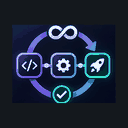

<p align="center"></p>
<h1 align="center">Orquestivo</h1>
<p align="center"><strong>CI/CD Workflow Studio for Visual Studio Code</strong><br><em>Design the pipeline. Verify the outcome.</em></p>

<p align="center">  </p>

---

## Build pipelines that do what you intend

YAML may be syntactically valid without delivering a correct or secure CI/CD outcome. **Orquestivo** is designed to bridge the gap between workflow configuration, developer intention and verification.

> **Private foundation; not a public release.** This version contains a limited, read-only GitHub Actions analyzer with native diagnostics. Generation, execution, AI assistance and multiple CI providers are on the roadmap, **not implemented yet**.

## Available in the foundation

| Capability | Scope |
| --- | --- |
| Workflow discovery | `.github/workflows/*.yml` and `*.yaml` |
| Static YAML validation | Parse errors and duplicate-key handling |
| Job dependencies | Unknown jobs, self-dependencies and cycles |
| Structure | Missing events, runners and steps |
| Security observations | Broad permissions, mutable action versions and privileged PR triggers |
| Reliability | Missing job timeouts |
| Developer experience | Activity Bar, Problems diagnostics and Control Center |
| Localization | English/Spanish UI shell; full rule localization pending |
| Privacy | Local-first; no telemetry, execution or cloud submission |
| Evidence | Static findings only; never claims that a pipeline executed |

## Development

Requires VS Code 1.99+, Node.js 22+ and a trusted local workspace.

```bash
npm install
npm run verify
npm run package
```

Install the VSIX via **Extensions → Install from VSIX…** and run **Orquestivo: Analyze GitHub Actions workflows**.

## Product principles

**Evidence before claims · Progressive disclosure for every seniority · Secure by default · Accessible by design · Strict TypeScript · SOLID, KISS, DRY, YAGNI · Independent quality gates.**

See [Architecture](ARCHITECTURE.md), [Roadmap](ROADMAP.md), [Security](SECURITY.md), [Privacy](PRIVACY.md) and [Release process](docs/RELEASE.md).

## Support

Submit reproducible problems through [ArmoTuSitio](https://armotusitio.com.ar/soporte/). Include sanitized workflow examples only. Do not share API keys, secret values or confidential CI logs.

---

<p align="center"><strong>Designed and developed by Alejandro Daniel Di Stefano</strong><br>© 2026 <a href="https://armotusitio.com.ar">ArmoTuSitio</a>. Copyright holder.<br>Released under the MIT License (included with the extension).</p>
